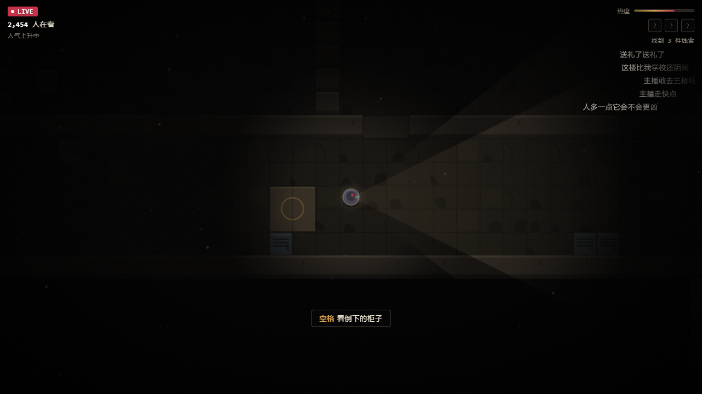

# 封校第七十三天 · 后夜直播

一个网页恐怖小游戏：一支为了流量翻进封闭中学的直播小队，在废弃教学楼里找三件线索，顺便被“她”追。

- **双击 `index.html` 就能玩**（纯前端，零依赖、零安装、不联网）
- 键盘 + 手机触屏都能玩，8–12 分钟一周目
- 画面与音效全部由代码实时生成，没有外部图片/音频文件



---

## 怎么玩

### 键盘

| 按键 | 作用 |
|---|---|
| `WASD` / `方向键` | 移动 |
| `Shift` | 奔跑（很快，但**声音传得很远**） |
| `空格` / `E` | 互动：看线索、躲进柜子/课桌、推门 |
| `F` | 手电筒开关（关灯更难被发现，但看不清路） |
| `L` | 开/关直播（热度会掉，鬼会安静下来） |
| `M` | 静音 |
| `Esc` | 暂停 |

### 手机

左下虚拟摇杆移动，右下三个按钮：**跑**（按住）、**互动**、**关播**。

---

## 核心机制

1. **三件线索**：保安室的监控主机、三年二班讲台抽屉里的信、女厕最后一间隔间的手机。每件都会展开一段文本，拼起来是 2019 年 10 月那件事的真相。
2. **她醒了**：拿到第一件线索后，器材室的门会自己打开，之后它会一直在这栋楼里走动。
3. **声音就是命**：走路噪音小，奔跑、开门、翻柜子都会把它引过来。地图上有几处能挡视线的柜子和课桌。
4. **躲藏**：柜子/课桌能躲，但**如果它看见你躲进去**，它会径直走到柜门前——这时只有立刻钻出来再跑。
5. **热度**：直播开着时，观看人数和热度会涨；热度越高，它看得更远、跑得更快。热度爆了会弹提示，按 `L` 关播可以降温（代价是没有观众替你尖叫报点）。
6. **弹幕会真的帮你**：热度够高时，观众会在它靠近时用弹幕喊方向。关播之后，这些提示也没了。
7. **天台门**：三件线索齐了才能推开北侧楼梯间的门。门后有两条路——把三段素材发出去，或者关掉直播删掉一切。

死亡会“信号中断”，可以原地重连：线索不会丢，但它会回到器材室重新开始，热度也会降一点。

---

## 项目结构

```
schoolHorror/
├─ index.html        # 页面骨架、HUD、各种覆盖层
├─ styles.css        # 全部界面样式（含手机适配）
├─ js/
│  ├─ data.js        # 配置数值、地图房间、场景物件、线索全文、弹幕池、结局文本
│  ├─ audio.js       # Web Audio 合成：环境嗡鸣、脚步、心跳、惊悚音效
│  ├─ world.js       # 瓦片地图生成、碰撞、视线判定、BFS 寻路
│  ├─ input.js       # 键盘 + 触屏摇杆
│  ├─ render.js      # Canvas 绘制、手电筒光照、柜门缝视野、静态场景烘焙
│  ├─ actors.js      # 玩家移动/体力/躲藏，影子 AI（巡逻/听声/追逐/搜寻/守柜门）
│  ├─ stream.js      # 直播：观看人数、热度、弹幕生成与危险提示
│  └─ game.js        # 主循环、状态机、互动、死亡重试、结局
└─ README.md
```

## 想改数值？

基本都在 `js/data.js` 顶部的 `CFG`：

```js
PLAYER_SPEED: 104,   // 走路速度
PLAYER_RUN: 186,     // 奔跑速度
STAMINA_MAX: 100,    // 体力
STAMINA_DRAIN: 26,   // 奔跑每秒消耗
GHOST_SIGHT: 250,    // 它的视野（开手电 +80，关手电 -50）
GHOST_CHASE: 146,    // 追逐速度（热度越高越快）
NOISE_RUN: 210,      // 奔跑噪音半径
```

房间/物件/线索文本在同一个文件里往下翻：`ROOMS`、`DOORWAYS`、`PROPS`、`CLUES`、`DANMAKU`、`STORY`。

## 兼容性

- Chrome / Edge / Firefox / Safari 现代版本。
- `file://` 直接双击可用（脚本都是普通 `<script>`，没有模块化加载，没有 fetch）。
- 若某些浏览器对本地文件限制较多，也可以在目录里跑一句 `python -m http.server 8000`，再打开 `http://localhost:8000`。
- 首次点击“开始直播”后才会启动音频（浏览器自动播放策略）。

## 已知限制

- 只做了一层楼 + 一只“她”；没有多周目存档（只把通关结局记在 localStorage）。
- 没有配音，队友的台词以文字形式出现在弹幕里。
- 无英文版本。
